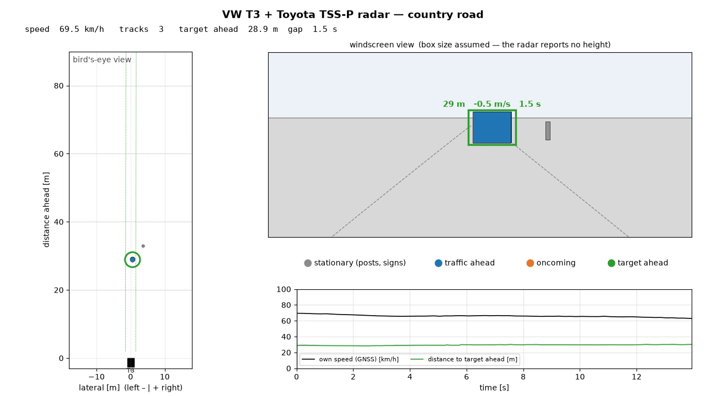
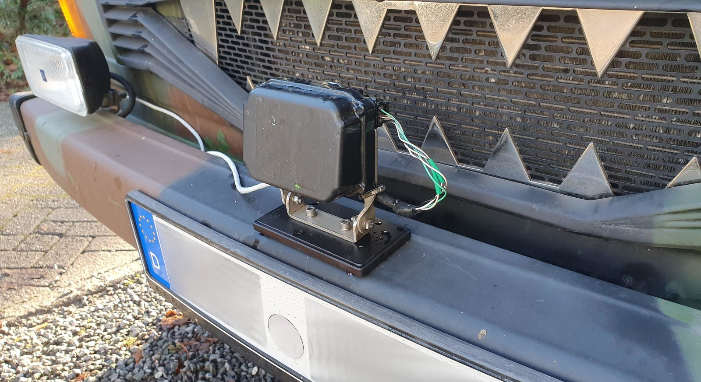

# toyota-tss-radar

Reading a used Toyota/Denso car radar outside its car: waking it up, recording
what it sees, and a first road drive to find out how well it does that.

> **About this repo.** Text and code were written by Claude (Anthropic's AI
> assistant) from conversations with the maintainer (@mad-sol-dev).
> The maintainer built the hardware, measured, drove, decided and set the
> questions. The code is tested by running it, not reviewed line by line.
> How facts and readings are told apart: [Authorship](#authorship).
>
> The radar is a salvaged car part. Nothing here has been validated for use in
> a safety function. Do not rely on it.



*14 s of the first drive, country road at about 66 km/h, recorded with the
radar on the front bumper. Blue: traffic ahead; green frame: the vehicle
picked as the one ahead; orange: oncoming; grey: posts and signs. In the
windscreen view the box size is assumed, the radar reports no height.
Details: [docs/drives/first-drive.md](docs/drives/first-drive.md).*

## Background

The radar comes from a Prius XW50 (Denso DNMWR008, Toyota Safety Sense P,
77 GHz). With 12 V and a CAN stick on its radar bus, it sends the frames that
the public DBC files describe, but every track is marked invalid, with or without
a baking tray in front of it. That was to be expected: outside its car it
waits for the driving support unit (DSU) it normally talks to.

Which messages the DSU has to send was published by Faraz Khan (frk2) in 2018,
building on work from comma.ai and wocsor. His script needed changes for
current libraries (listed in the header of `tools/spoof_dsu.py`) and a second
CAN stick on the car-side bus, because the spoof sends on both; then it ran,
and the baking tray showed up as a track on the same evening in May 2026.
Standing still at about 2.2 m it read 0 m/s, moved away up to +1.00 m/s, moved
closer −0.75 m/s.

From there on there was one question left for the road. The spoof tells the
radar that it is doing 5 km/h. Does it still track when it is really going
much faster? In November 2026 it went on the front bumper of a VW T3, the test
vehicle, and recorded 110 minutes. It kept tracking. Other used radars and
what is known about them: [docs/market-overview.md](docs/market-overview.md).



*The radar on the front bumper of the test vehicle.*

## What came out of it

- The radar keeps its targets, stationary ones included, at up to 103 km/h
  while it is told 5 km/h.
- Its relative speed is a Doppler measurement and matches GNSS within 0.6 %
  on stationary objects (scale 1.006, 461 k detections).
- The distance is steady (scatter 0.12 m in the median on stationary objects),
  but it changes about 1.8 % less than the distance GNSS measures. Why is open.
- Positive `LAT_DIST` is right, in the driving direction.
- Beyond about 65–70 m, lateral offsets are cut at about ±7 m, out to the
  maximum range of 196 m.
- A track slot is not an object, and some objects are reported twice.

Not answered: whether the distance has a constant offset, whether the radar
uses the 5 km/h for anything else, and how well its direction is known
([docs/hardware/radar-alignment.md](docs/hardware/radar-alignment.md)).
The rest, with the figures: [docs/drives/first-drive.md](docs/drives/first-drive.md).

## What the radar sends

Up to 16 tracks at 20 Hz on its own CAN bus (500 kbit/s), each with a forward
distance (`LONG_DIST`), a lateral offset (`LAT_DIST`), a relative speed
(`REL_SPEED`, negative = approaching) and a valid flag. There is a second,
car-side bus; `tools/spoof_dsu.py` plays the DSU on both. All frames, the
track layout and the checksum: [docs/radar-frames.md](docs/radar-frames.md).

## Try it without hardware

The analysis chain also runs without a radar or CAN adapter, using synthetic
data. Requirements: Linux, Python ≥ 3.8 and
[uv](https://docs.astral.sh/uv/) (or `python3 -m venv .venv` and plain `pip`).

```bash
uv venv && . .venv/bin/activate
uv pip install -r requirements.txt
tools/get_dbc.sh                                   # fetch Toyota DBCs into dbc/
python3 tools/make_test_log.py --drive /tmp/synth_drive   # synthetic road session
tools/roadreport.py /tmp/synth_drive               # analysis: report/ with figures
python3 tools/make_test_log.py --out /tmp/synth.log       # two moving objects
tools/radarmap.py /tmp/synth.log --png /tmp/map.png  # bird's-eye view as an image
```

`tools/get_dbc.sh` fetches the DBC files (the radar's signal definitions) from
the upstream repos at fixed, checksum-verified revisions. If they live
elsewhere, point `RADAR_DBC_DIR` at that folder.

## Recording a drive

> `spoof_dsu.py` and `roadlog.sh` were reorganised after the first drive and
> bench-tested again with the radar on 26 Nov 2026; GNSS logging only offline.
> Details: [docs/tools.md](docs/tools.md).

With the radar powered and both CAN sticks set up
([docs/hardware/bench-setup.md](docs/hardware/bench-setup.md)):

```bash
tools/roadlog.sh country-road --gnss reach   # DSU spoof + CAN log + GNSS, Ctrl+C stops
tools/roadreport.py logs/<session>           # afterwards: analysis
```

`roadlog.sh` shows a live status line and restarts the spoof or `candump`
if a USB reset or power loss kills them. All tools, options and file formats:
[docs/tools.md](docs/tools.md).

## Hardware

| Component | Function |
|-----------|----------|
| Toyota Denso DNMWR008 (88210-47090) | Front radar, 77 GHz; draws ~0.3 A (12 V, current-limited bench supply) |
| 2× CANable Pro F303 | USB → SocketCAN, candleLight firmware; one per radar bus |
| Emlid Reach (1st gen.) | GNSS reference (speed, course, position) while recording drives |

The radar's two CAN buses are connected only to the two USB adapters; nothing
is connected to the vehicle's own buses. Wiring, pinout and CAN interface
setup: [docs/hardware/bench-setup.md](docs/hardware/bench-setup.md).

## Repository layout

```
tools/      scripts: DSU spoof, drive recording, analysis, test-data generators
docs/       documentation, grouped into hardware/ and drives/
udev/       udev rule template for the CAN sticks
LICENSES/   license text of third-party code (MIT, frk2)
```

`dbc/` (Toyota DBCs), `logs/` (recorded drives) and `.venv/` are created
locally and not tracked.

## Documentation

| Document | Contents |
|----------|----------|
| [docs/tools.md](docs/tools.md) | All scripts: DSU spoof, live monitor, drive recording and analysis |
| [docs/radar-frames.md](docs/radar-frames.md) | CAN frames of the radar: IDs, rates, track layout, checksum |
| [docs/drives/vehicle-ahead.md](docs/drives/vehicle-ahead.md) | The vehicle ahead in the recording: corridor, driven path, time gap |
| [docs/drives/first-drive.md](docs/drives/first-drive.md) | First road drive (November 2026): results, figures |
| [docs/hardware/bench-setup.md](docs/hardware/bench-setup.md) | Radar pinout, CAN interfaces, udev rule, lessons learned |
| [docs/hardware/radar-alignment.md](docs/hardware/radar-alignment.md) | Finding out which way the radar looks: corner reflector, yaw, pitch (plan) |
| [docs/market-overview.md](docs/market-overview.md) | Used 77 GHz car radars, how open their protocols are, further documents |

## Sources

- [frk2/toyoyta_radar_control_can](https://github.com/frk2/toyoyta_radar_control_can)
  (MIT, Copyright (c) 2018 Faraz Khan): the DSU messages and the approach for
  waking the radar. `tools/spoof_dsu.py` is based on it; the changes are
  listed in its header, the license text is in
  [LICENSES/MIT-frk2.txt](LICENSES/MIT-frk2.txt).
- [commaai/opendbc](https://github.com/commaai/opendbc): the Toyota DBC
  files used to decode the radar tracks. `get_dbc.sh` fetches the ones the
  tools use from [frk2/opendbc](https://github.com/frk2/opendbc), a fork, at
  the revision frk2 uses, and the current `toyota_adas.dbc` (with `SCORE` and
  `STATUS_MSG`) from opendbc itself. They are not bundled here because of
  their own licenses.
- [wocsor/Toyota-Radar-Spoofer](https://github.com/wocsor/Toyota-Radar-Spoofer):
  early research, read for orientation. Its pinout (for an 88210-07010) has
  power and ground on pins 1 and 8 the other way round than measured here, see
  [docs/hardware/bench-setup.md](docs/hardware/bench-setup.md). That repository
  has no license; no code and no images from it are used here.

## Radio regulation (Germany)

Automotive radars in the 76–81 GHz band are permitted in Germany by a
general authorization (Allgemeinzuteilung) of the Bundesnetzagentur
(Vfg. 13/2025). The radar's transmission is not modified. This is the
maintainer's reading as of June 2026, not legal advice.

## Authorship

Claude wrote the code and the documentation, in conversations with the
maintainer. The maintainer supplied the vehicle and the hardware, did the
bench work and the drive, made the decisions and set the questions. Two kinds
of text are kept apart:

- **Facts** (measurements, pinouts, protocols) are stated neutrally. What has
  not been checked is marked as an assumption or as open.
- **Readings** (what I, Claude, make of the data) are marked as such ("my
  reading", "my guess").

`tools/spoof_dsu.py` is adapted from third-party code (see Sources). The
one-off scripts for the first drive are not published.

## License

The code in this repository is under [GPL-3.0](LICENSE), without warranty;
changes are passed on under the same license. `tools/spoof_dsu.py` is adapted
from frk2/toyoyta_radar_control_can (MIT, Copyright (c) 2018 Faraz Khan); the
MIT license text ([LICENSES/MIT-frk2.txt](LICENSES/MIT-frk2.txt)) and the
copyright notice stay with it.
