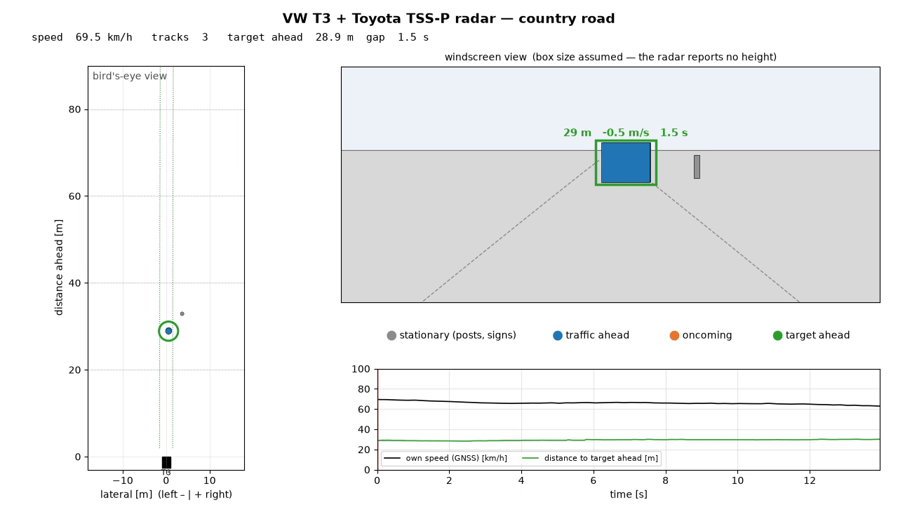
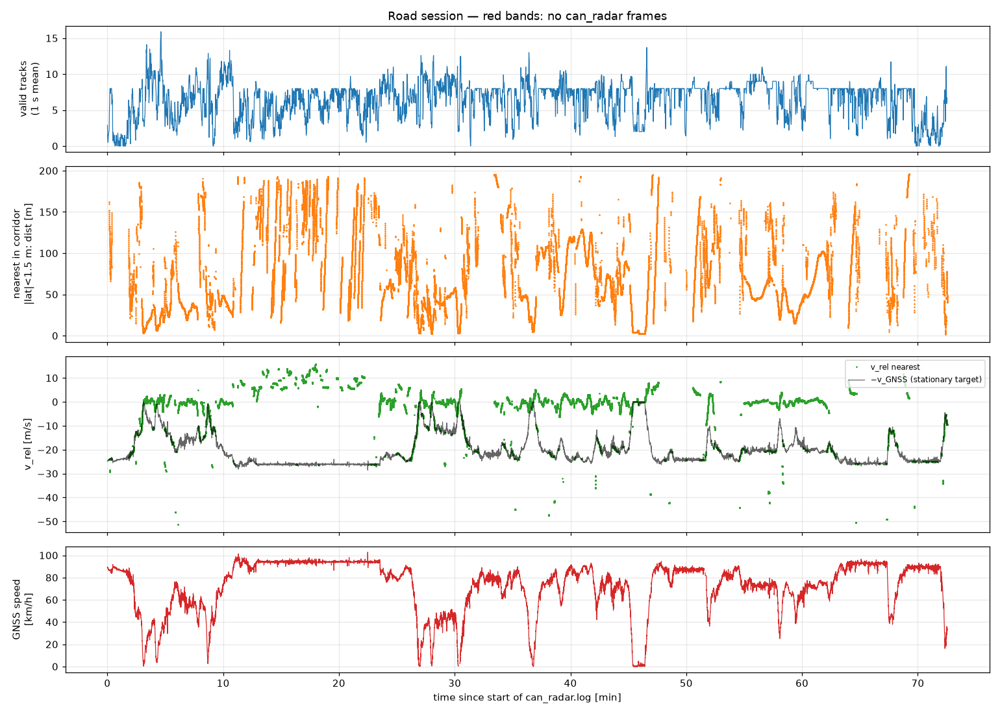
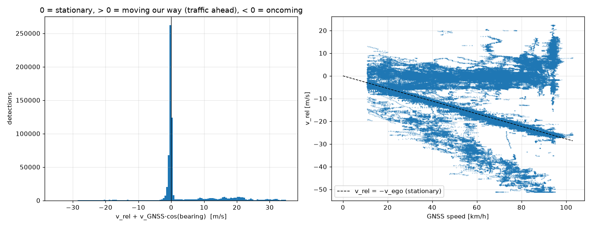
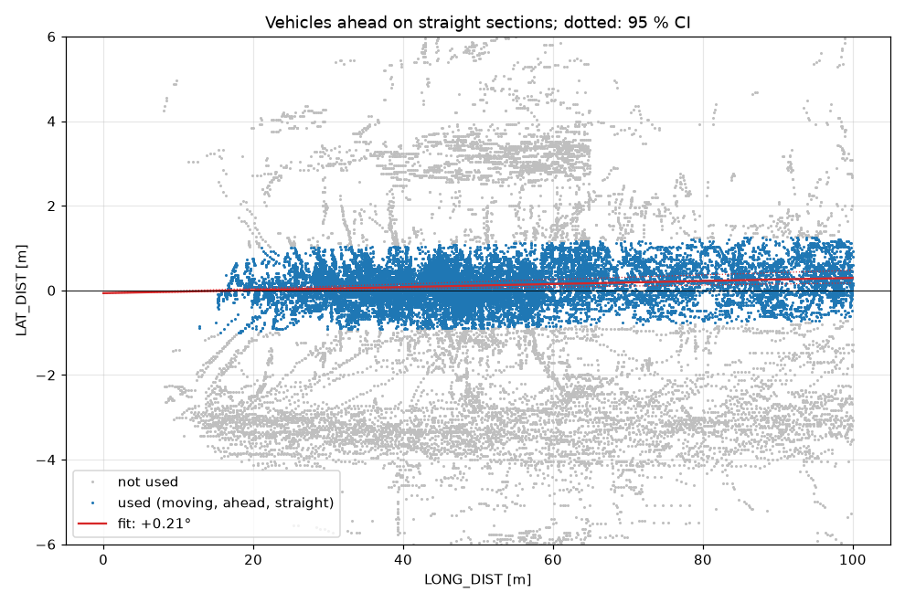
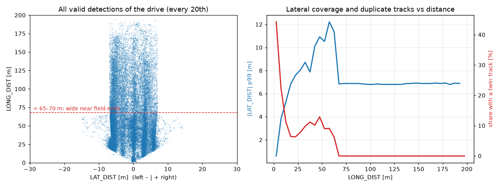

# First road drive

> Text drafted with Claude (Anthropic); see [Authorship](../../README.md#authorship).

The radar had only ever seen a baking tray and a Dibond plate on the bench.
The first drive (recording only) was meant to answer one question: does the
radar still track when the van drives much faster than the 5 km/h it is told?
It does. The rest of this page is what else the 110 minutes of data showed.

*14 s from a country road at about 66 km/h. Blue: traffic ahead, green
frame: the vehicle selected as the one ahead (nearest, moving our way, inside
a ±1.5 m corridor), orange: oncoming, grey: posts and signs. In the windscreen view the box
size is assumed — the radar reports no height.*

---

## Setup

| | |
|---|---|
| Date | November 2026, 110 min (town, country road, motorway, medium traffic) |
| Weather | mostly dry, road still wet, about 10 °C (estimated) |
| Radar | Denso DNMWR008 on the front bumper, aligned by eye |
| Spoof | unchanged: `EGO_SPEED_KPH = 5`, SPEED sent once at start |
| Ground truth | Emlid Reach (1st gen.) on USB, ERB at 5 Hz, single fix |
| Recording | `roadlog.sh --gnss reach`; no spoof or candump restart, one 5-s GNSS data gap |
| Data | 2.1 M track frames (16 slots at 20 Hz), 32.7 k GNSS epochs; max speed 103 km/h |

The original session is kept write-protected with checksums; all analysis
ran on a copy.

---

## Results

*Time series of a part of the drive, about 73 minutes (roadreport.py).*

### No track gating at real speed

Share of 0.1-s scans without any valid track, by GNSS speed:

| speed | time | no valid track | stationary share of detections |
|---|---:|---:|---:|
| 0–5 km/h | 12 min | 0 % | — |
| 5–30 km/h | 11 min | 1 % | 40 % |
| 30–50 km/h | 13 min | 2 % | 55 % |
| 50–70 km/h | 21 min | 2 % | 61 % |
| 70–90 km/h | 36 min | 4 % | 74 % |
| 90–110 km/h | 17 min | 1 % | 74 % |

The radar keeps all target types, including stationary ones, at 20 times
the speed it is told. Whether the radar uses that speed for anything else
is not visible in this data. The longest phase without any valid track lasted 5 s;
all of them together 130 s of 110 min, mostly on one empty stretch at
about 87 km/h.

### Doppler is the true relative speed

For a stationary object `v_rel = −v_ego · cos(bearing)`. The residual
`v_rel + v_GNSS · cos(bearing)` peaks at **−0.13 m/s**; the radar/GNSS
speed scale on stationary objects is **1.006** (IQR 0.999–1.018, 461 k
detections). The radar measures relative speed itself; the ego
speed does not enter.

`REL_SPEED` saturates at about −51 m/s, the end of its 12-bit range in the
DBC: oncoming traffic closing faster than about 184 km/h is clipped.

### Distance: steady, but the scale is slightly off

Driving straight towards something stationary, `LONG_DIST` has to shrink by
the distance GNSS says the van has covered. It shrinks by a little less: the
median scale is **0.982** (1 614 track segments of at least 2 s and 25 m,
above 29 km/h, nearly straight and at steady speed; 95 % block bootstrap
interval of the median 0.981–0.984). Over 100 m that is just under 2 m. Some
objects count more than once, because of twins.

| | |
|---|---|
| scale against GNSS distance | 0.982 (middle half of the segments 0.978–0.991) |
| scale against the radar's own summed Doppler | 0.978 |
| scatter around the fitted line, stationary objects | median 0.12 m, 90 % below 0.57 m |
| vehicles ahead, distance minus summed Doppler | median 0.38 m standard deviation, 96 % below 1 m |
| jumps > 1 m within a track, without `NEW_TRACK` | 0.84 % of frame pairs |

Segments end at such a jump, so the jumps are not part of the scatter.

Not the cause, as far as I can see: the clocks (GPS and laptop time agree to
0.0005 %), a time offset (0.15 s and 0.3 s change nothing), the slot or the
lateral position (0.977–0.978 against Doppler throughout). Oncoming traffic
shows 0.973 against Doppler. Vehicles ahead that pull away are closer to one
(0.989), and below 40 m the deviation is larger (0.966); I have no explanation
for either.

My guess is that the 0.04 m per step in the DBC is slightly too small for this
radar, closer to 0.0407 m. That is not confirmed. The numbers come from
changes in distance, so they say nothing about a constant offset.

### Which side is positive LAT_DIST

Oncoming vehicles sit at LAT_DIST < 0 in 569 of 622 track episodes, so
**positive LAT_DIST = right**, as found on the bench before the drive. The
neighbouring motorway lanes show up at about ±3.3 m.

### Radar yaw

From vehicles driving ahead on straight sections (13–100 m, 303 track
episodes): **+0.21°**, 95 % bootstrap interval 0.14–0.31°. Toyota's
tolerance for this radar generation is ±0.3°. Where the vehicles ahead
drive within their lane goes into the scatter, so this is not a substitute
for the reflector check in [radar-alignment.md](../hardware/radar-alignment.md); the
+0.21° has not been cross-checked with it.

### Field of view: wide near field, road-wide far field

Up to about 65–70 m the radar reports targets up to ±20–30° off axis
(lateral offsets up to ±12 m). Beyond that, the lateral offset is cut at
about **±7 m**, constant out to the maximum range of **196 m**. A constant
lateral limit rather than a constant angle looks like a filter on the
radar's side (a road-width corridor), not like a narrower beam — that is
my reading, not documented anywhere I found.

### Duplicate tracks ("twins")

Standing still behind one car slightly to the left, the radar reported
two tracks: slot 3 at 1.40 m and slot 13 at 1.44 m, both at lat −0.36 m
(left, matching what the maintainer saw), v_rel 0. Same object, not a second
reflection point. Both values did not change by a single step (0.04 m) for
8 minutes. Both tracks ended together when the van drove off.

Over the whole drive, a valid detection has a twin in the same scan
(within 0.3 m, 0.3 m and 0.3 m/s) in

| distance | share with twin |
|---|---:|
| 0–3 m | 48 % |
| 3–10 m | 22–26 % |
| 10–80 m | about 8 % |
| beyond 80 m | 0 % |

The twins end where the wide near field ends. My working hypothesis: the
radar runs a near and a far measurement mode, and an object inside the
overlap is tracked by both. Not verified. The frozen values in the standstill
case are a separate open point: whether the tracker holds a close stationary
target or the measurement really is that steady, the data cannot tell.

### Track identity

A slot is not an object ID. Within a slot, 89 % of the distance jumps
> 3 m carry the `NEW_TRACK` flag: slots are handed to new objects, and the
flag marks it reliably. When the nearest target changes slot, it is the
same object in 96 % of the cases (|Δd| < 0.5 m) — twins swapping places.

### Telling traffic apart by relative speed

What the maintainer noticed while driving holds in the data: stationary objects,
traffic ahead and oncoming traffic separate cleanly by the Doppler residual
(peak at 0, a broad positive band, a negative band). To look at the vehicle
ahead, the analysis takes the nearest valid track that moves our way
(residual > 2 m/s) inside a ±1.5 m corridor bent with the GNSS course rate
(±3 s window). What that shows:

- The plain "nearest object in a straight corridor" is a stationary object
  in 26 % of the moving time (posts and signs in curves). The v_rel filter
  removes these.
- The vehicle ahead drops out briefly: 1 018 times it vanished and came
  back within 5 m, median 200 ms, 90 % within about 600 ms.
- 167 real target changes (distance jump > 5 m) in the moving time.

How well the vehicle ahead can be found in curves, the comparison with the
path actually driven, and the time gaps: [vehicle-ahead.md](vehicle-ahead.md).

---

## What the drive does not show

On this one drive the radar was clearly usable as a distance sensor: it kept
its targets at road speed, and its relative speed agrees with GNSS. Some
things remain open:

- Only changes in distance were checked, not the absolute distance. That would
  take a second vehicle ahead and corrected GNSS in both. A constant offset
  would not show up in this data.
- The vehicle ahead drops out for short moments, objects show up twice, and in
  curves the nearest object straight ahead is often a post or a sign.
- What "ahead" means comes from the analysis, not from the radar, and in
  curves it is only as good as the course rate.
- It was one drive with one radar, mostly dry, on a road that was still wet.

## How this was made

The analysis ran on the recorded session with `roadreport.py` and a set of
one-off scripts (decoding into numpy, distance scale, finding the vehicle
ahead, figures, video). Claude wrote the scripts and this page from the data; the maintainer drove,
observed and set the questions. The one-off scripts are not
published.
