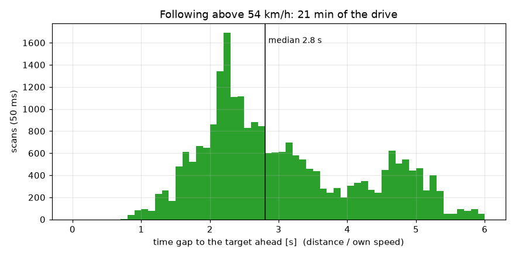

# The vehicle ahead in the first-drive data

> Written by Claude (Anthropic) from conversations with the maintainer and the
> measurements; see [Authorship](../../README.md#authorship).

The radar reports objects; which of them is the vehicle ahead is up to the
analysis. This page shows how far that works with the recording of the
[first drive](first-drive.md), using GNSS alone. The vehicle ahead is the
nearest valid track that moves our way, inside a ±1.5 m corridor.

## Bending the corridor needs a calm yaw rate

The corridor is a prediction: the current course rate divided by speed
gives a curvature, and the corridor follows that curvature ahead. A
curvature error grows with distance squared — 0.5 °/s of yaw-rate noise at
65 km/h moves the corridor by about 2 m at 90 m. The Reach's course comes
from the velocity of a single (non-RTK) fix and is noisy, so the smoothing
window decides a lot:

| course rate window | target present (moving) | short drop-outs | target changes > 5 m | in curves (R < 600 m) |
|---|---:|---:|---:|---:|
| ±0.5 s | 30 % | 3 226 | 480 | — |
| ±1.5 s | 40 % | 1 784 | 290 | — |
| ±3 s | 44 % | 1 018 | 167 | 44 % |
| straight corridor | 41 % | 203 | 86 | 25 % |

A straight corridor is calmest but loses the target in curves; ±3 s is the
best compromise with GNSS alone.

## The driven path as a reference

Afterwards, the path the van actually drove next is known. Built from the
single-fix positions it is useless as a corridor: they wander by about 1 m
within a second or two, already at 10–30 m look-ahead. Built by dead
reckoning from the GNSS velocity (Doppler speed and course), it is smooth:
on straight sections it stays within 0.3 m at 30 m (median).

Against that reference, the ±3-s course corridor is off by (median / share
within the ±1.5 m corridor) 0.2 m / 96 % at 30 m, 0.5 m / 82 % at 60 m,
0.9 m / 65 % at 90 m.

Used as the corridor itself, the driven path does not find the vehicle
ahead more reliably overall (target present 44 %, 48 % in curves; 1 381 short drop-outs, 293
target changes). My reading: the vehicle ahead is in a lane, not on the
exact line the van drives next — lane changes, overtaking and the van's own
weaving move the driven path away from it. To tell which
vehicle is ahead, knowing the lane matters more than knowing the own future
path to the decimetre.
The ±3-s window lacks the look-ahead at curve entries. A first version of this analysis used ±0.5 s; the wobbling
corridor produced most of the drop-outs it reported.

## Time gap

Following above 54 km/h (21 min): median time gap 2.8 s, 10 % of the time
below 1.8 s, 0.5 % below 1.0 s.

